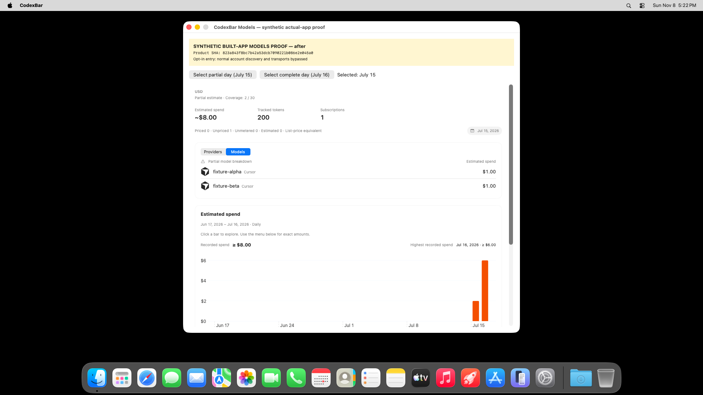
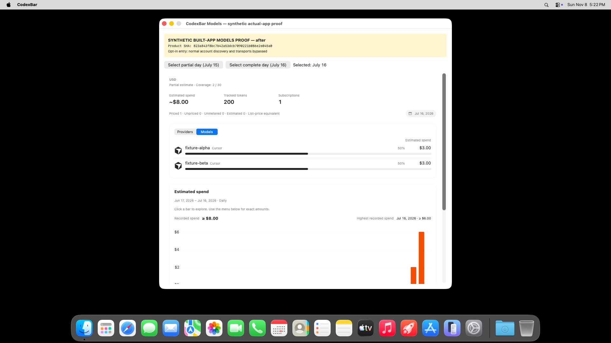

# Native app proof for CodexBar #5024

[Product PR](https://github.com/steipete/CodexBar/pull/5024) · [Successful capture run 42503155244](https://github.com/Chipagosfinest/CodexBar/actions/runs/42503155244) · [Capture controller and fixture source](https://github.com/Chipagosfinest/CodexBar/tree/ba3c300d839aa19d9311231ca5e976c55c88de36/modelsproofkit)

Baseline product: `7447bc77c2497323d9c41e40164ce705533493c8`.
Fixed product: `823a843f8bc7b42a53dcb7090221b086e2e045a0`.
Controller: `ba3c300d839aa19d9311231ca5e976c55c88de36`.

## Observed behavior

Both full debug app packages were built sequentially in the same disposable hosted macOS worktree. The opt-in fixture enters before normal settings/account/provider initialization and hosts the production `SpendDashboardCurrencySection` in its Models state, using the production model builder and ranking. All data is synthetic, the process has a contained home and denied network, and the full product SHA/banner is visible. The fixture chrome selects the day; the driver performs an actual pointer click on its accessibility-discovered button in the retained native window.

| State | Baseline | Fixed |
|---|---|---|
| July15, two known $1 costs plus one unpriced request | Incorrect 50%/50% and bars; no Models partial warning | Both $1 amounts retained; Partial model breakdown; no shares or bars |
| Select complete July16 | Both $3 amounts, valid 50%/50% and bars | Both $3 amounts, valid 50%/50% and bars; no Models partial warning |

The top summary/chart retain the known two-day window cost of $8. The Models panel is selected-day scoped; selecting July16 does not make the whole window complete. Runtime JSON explicitly records this distinction.

### Baseline: partial day incorrectly has shares

### Fixed: known amounts remain, unsupported shares disappear

### Fixed: selecting the complete day restores valid shares

## Verification and limits

- Root and capture worker inspected the selected original-resolution 1920x1080 actual-screen images. They contain no sensitive account data or obstructing notifications; the critical controls/rows fit the visible native window.
- Both capture drivers passed 9/9 assertions (18 total), including row amounts, selected-day transition, share visibility and independent whole-window partial state. Inspect `before/verdict.json`, `after/verdict.json` and the day JSON files.
- Every screenshot hash agrees with its runtime manifest. All four exercised production-source hashes agree with immutable product Git blobs. Native packages passed deep/strict code-signature verification. Baseline and fixed runs use the identical fixture overlay; complete deltas and source/executable hashes are retained in each folder.
- This is a fixture-driven packaged-app/component journey, not real-provider/account proof, normal settings-window navigation, or an installed-release claim. Normal startup is intentionally bypassed. It does not replace full PR CI.
- macOS26.6.1, Xcode26.6, Swift6.3.3; details in environment.txt. The preflight verified Aqua, AX trust, pointer injection, capture and recording capabilities before building.
- Reproduction: controller branch `proof/models-5024-actual-ui-20261108`, pinned workflow `.github/workflows/models-actual-ui-proof.yml`. It checks out the two product SHAs, applies the recorded opt-in fixture, builds both packages, captures partial and clicked-complete states, then uploads reports/images. Capture plumbing is absent from the two-file product PR.
