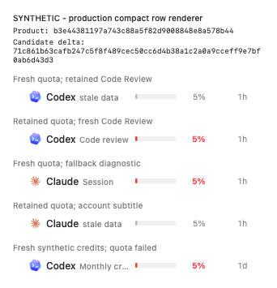
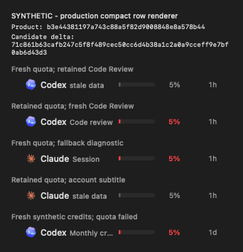

# Dropdown review regression proof

Verified hosted behavioral REDs precede the candidate source fixes. The bounded candidate run [42188062340](https://github.com/Chipagosfinest/CodexBar/actions/runs/42188062340), controller `8e66c4240fd6021b4b7618b93ce7bf4b10c3b140`, finished successfully in all four jobs.

| Case | Verified behavioral RED | Candidate GREEN | Artifact |
| --- | --- | --- | --- |
| Core freshness | 12 tests / 19 expected issues; existing metric-row controls passed | 35 tests in 3 suites, 0 issues | [Core green](https://github.com/Chipagosfinest/CodexBar/actions/runs/42188062340/artifacts/13488732545) |
| Chart partial history | Enhanced identical oracle: 19 tests / 4 expected issues | Same 19 tests, 0 issues | [Chart red](https://github.com/Chipagosfinest/CodexBar/actions/runs/42188062340/artifacts/13489520138), [chart green](https://github.com/Chipagosfinest/CodexBar/actions/runs/42188062340/artifacts/13489245466) |
| Footer plugin refresh | 1 test / 3 expected issues after the compilation-only attempt was rejected | Same 1 test, 0 issues | [Footer red](https://github.com/Chipagosfinest/CodexBar/actions/runs/42185608436), [footer green](https://github.com/Chipagosfinest/CodexBar/actions/runs/42188062340/artifacts/13488797678) |

Core and footer regression-source hashes are unchanged from their verified REDs. The enhanced chart RED/GREEN test file is byte-identical. Green includes the original compact-row and complete-chart controls, preserving source-aware freshness, complete-range 80/20 shares, Other-folding sum, daily dollar totals and 40%/60% daily shares. Unknown range shares remain unknown.

## Exact candidate inputs

| Case | Immutable product baseline | Explicit production delta SHA256 |
| --- | --- | --- |
| Core | `b3e44381197a743c88a5f82d9008848e8a578b44` | `71c861b63cafb247c5f8f489cec50cc6d4b38a1c2a0a9cceff9e7bf0ab6d43d3` |
| Chart | `cf6efdea76161eb3061e0b954d8150231181149f` | `ff58b5ad03850718a6ffe37f4b3ef132582bb770b1c8853e1fc5352518025194` |
| Footer | `13185f0888b8e60ad22f72d66767f23601d7b960` | `2ab6893d696a73df718f1529d9c4cdad651a688408ba68f32f21e5a0833206e8` |

Both lanes independently compared all 1,447 / 1,448 / 1,446 production Swift-file hashes and selected product test hashes with the hosted expected manifests: zero mismatches. Full local product `make check` passed for all three candidates; SwiftLint reported 0 violations across 3,182 / 3,184 / 3,181 files respectively. Candidate patches and complete test-harness deltas are retained in the artifacts and [proofkit patches](patches/).

## Native compact-row visual proof

The core's opt-in render ran only after its deterministic regressions passed. It rendered the actual `OverviewProviderLineView` at the production 310-point width from unchanged production `Model.make` fixture builders. Five synthetic states cover retained Code Review with fresh quota, fresh Code Review with retained quota, fresh fallback diagnostic, retained quota under an informational account subtitle, and independently refreshed synthetic credits.

Both original-resolution 342 x 379 PNGs were inspected by the lane and lead. Retained data is gray; fresh near-limit data stays red. Full baseline and candidate-delta identities are visible in the synthetic banner; [decoded states](results/20261106/states.json) agree with the images. [SHA256 manifest](results/20261106/render-sha256.json).

| Light | Dark |
| --- | --- |
|  |  |

This is a fixture-driven production-view render and bounded production-model/menu regression proof. It does not establish an installed-app journey, real provider fetch, account authentication, or current public-PR CI. Final product commits must retain the tested source bytes and obtain their own required checks. Maintainer product decisions remain separate. [Machine-readable verdicts and provenance](results/20261106/verdicts.json).
